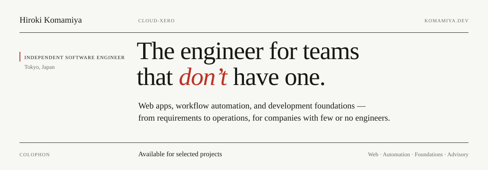

<a href="https://komamiya.dev">
  <picture>
    <source media="(prefers-color-scheme: dark)" srcset="./assets/profile-header-dark.svg" />
    <source media="(prefers-color-scheme: light)" srcset="./assets/profile-header.svg" />
    
  </picture>
</a>

PORTFOLIO **[komamiya.dev ↗](https://komamiya.dev)** &nbsp; — &nbsp; Selected work, products, and how I work, in English and Japanese.

  <a href="#about">About</a> &nbsp; / &nbsp;
  <a href="#what-i-do">What I do</a> &nbsp; / &nbsp;
  <a href="#products">Products</a> &nbsp; / &nbsp;
  <a href="#client-work">Client Work</a> &nbsp; / &nbsp;
  <a href="#contributions">Contributions</a>

 

## § 1 &nbsp; About

I’m an independent software engineer based in **Tokyo, Japan**. From web apps to workflow automation, development foundations, and technical advisory, I support teams that have few or no engineers of their own.

I work directly with marketers, sales teams, and the people doing the work to pin down requirements, then carry it through design, implementation, and deployment. What I value most is leaving behind systems that keep running without me.

 

## § 2 &nbsp; What I do

**1.1 &nbsp; Web application development** 
From requirements to design, implementation, and operations, mainly with Next.js and Astro.

**1.2 &nbsp; Automation & DX** 
Reducing manual work with GAS, Teams bots, and internal tools, in a form the team can keep running.

**1.3 &nbsp; Development foundations & AI** 
Templates, CI/CD, and IaC, plus Claude Code workflows that standardize how a team builds.

**1.4 &nbsp; Technical advisory & mentoring** 
Choosing technology for teams without engineers, and mentoring people until they can work on their own.

 

## § 3 &nbsp; Products

Services I build and run myself.

**3.1 &nbsp; [Abstria ↗](https://abstria.app)** &nbsp; BETA · abstria.app 
A goal management app that breaks a yearly goal down into months, weeks, and days, and lays it out as a mandala chart. 
<i>Next.js, Supabase, Stripe, Cloudflare Workers</i>

**3.2 &nbsp; [Background Slideshow ↗](https://github.com/Cloud-Xero/obsidian-background-slideshow)** &nbsp; OPEN SOURCE · [Obsidian community](https://community.obsidian.md/plugins/background-slideshow) 
An Obsidian plugin that shows a background image slideshow with fade transitions, from vault images, web URLs, or random photos. 
<i>TypeScript, Obsidian API</i>

**3.3 &nbsp; [AI Plugins ↗](https://cloud-xero.github.io/ai-plugins/)** &nbsp; OPEN SOURCE · cloud-xero.github.io/ai-plugins 
A catalog of Claude Code plugins for business strategy, marketing, and client development work. 
<i>Claude Code, Next.js, GitHub Pages</i>

 

## § 4 &nbsp; Client Work

Contract engagements, newest first. Clients are described by industry.

| Period         | Role                | Engagement                                            |
| -------------- | ------------------- | ----------------------------------------------------- |
| 2024 — 2026    | Full-stack Engineer | Web development for a medical media company           |
| 2023 — Present | DX Engineer         | DX for a sales company, as its only engineer          |
| 2021 — Present | Technical Advisor   | Technical support for a web agency                    |
| 2023 — 2024    | Full-stack Engineer | Feature development for a medical recruiting service  |
| 2022 — 2023    | Corporate Engineer  | Internal tools for a marketplace app company          |

Details on <a href="https://komamiya.dev/work">komamiya.dev/work ↗</a>

 

## § 5 &nbsp; Contributions

**5.1 &nbsp; [EmDash Forms plugin ↗](https://github.com/emdash-cms/emdash/pull/4078)** &nbsp; IN REVIEW · emdash-cms/emdash#4078 
Fixed whitespace leaking into empty textareas in EmDash’s Forms plugin, which let blank required fields pass browser validation. 
<i>Astro, TypeScript, Vitest</i>

 

<picture>
  <source media="(prefers-color-scheme: dark)" srcset="https://raw.githubusercontent.com/Cloud-Xero/Cloud-Xero/output/github-contribution-grid-snake-dark.svg" />
  <source media="(prefers-color-scheme: light)" srcset="https://raw.githubusercontent.com/Cloud-Xero/Cloud-Xero/output/github-contribution-grid-snake.svg" />
  
</picture>

---

COLOPHON **[komamiya.dev ↗](https://komamiya.dev)** &nbsp; · &nbsp; **[LinkedIn ↗](https://www.linkedin.com/in/hiroki-komamiya/)** &nbsp; · &nbsp; **[Email](mailto:hiroki-k@mail.grokbot.com)** Available for selected projects · Tokyo, Japan
